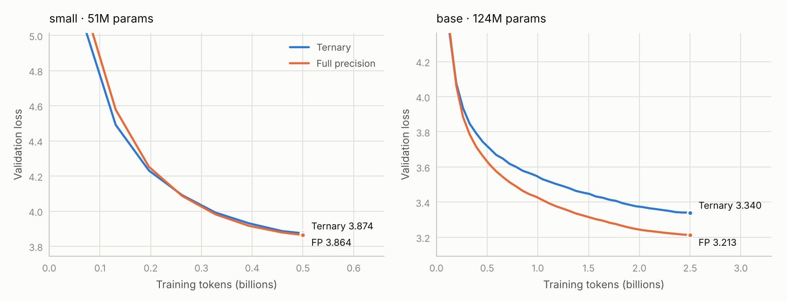
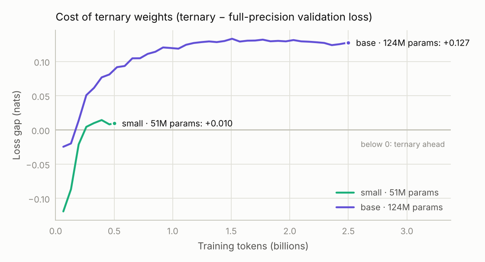

# Bonsai-style ternary LLMs on a single consumer GPU

Training GPT-style language models whose weights are restricted to **{−1, 0, +1}**, from
scratch, on a single **RTX 3060 (12 GB)**, and measuring exactly what the ternary format costs
compared with an identical full-precision model.

**Highlights**

- Two controlled pairs of models (**51M** and **124M** parameters), each trained twice under
  identical conditions: once with ternary weights, once in full precision.
- The 124M ternary model was trained on **2.5 billion tokens** of FineWeb-Edu in **33 hours**
  at about 21k tokens/s, and reached a validation loss of **3.340** (perplexity 28.2).
- Its ternary layers are stored at **1.725 bits per weight**, **9.3× smaller** than FP16.
  The whole packed model (95.7 MB) fits in this repository; its full-precision twin does not.
- Everything is written from scratch in PyTorch: the data pipeline, the model, the ternary
  quantization with a straight-through estimator, base-3 weight packing and evaluation tools.

> Inspired by the ternary format of PrismML's
> [Bonsai 2](https://prismml.com/news/bonsai-2-27b) models and by
> [BitNet b1.58](https://arxiv.org/abs/2402.17764). This is an independent project, not
> affiliated with PrismML, undertaken as a Friday night experiment intended to better understand ternary LLMs.

---

## Results

| Model | Parameters (ternary share) | Training tokens | Ternary val. loss | Full-precision val. loss | Gap | Perplexity |
|---|---|---|---|---|---|---|
| small | 51.4M (26M, 50%) | 0.5B | 3.874 | 3.864 | **+0.010** | 48.1 vs 47.7 (+1.0%) |
| base | 123.6M (85M, 69%) | 2.5B | 3.340 | 3.213 | **+0.127** | 28.2 vs 24.8 (+13.6%) |

<picture>
  <source media="(prefers-color-scheme: dark)" srcset="figures/loss_curves-dark.png">
  
</picture>

<picture>
  <source media="(prefers-color-scheme: dark)" srcset="figures/gap-dark.png">
  
</picture>

**What the curves show**

- **Ternary starts ahead.** Early in training the ternary models lead, mostly because they use
  a higher learning rate (1.5e-3 versus 6e-4), not because ternary weights learn faster.
- **Full precision overtakes after about 0.2–0.25B tokens** and a stable gap opens.
- **At 51M parameters the cost is small** (+0.010 nats, about 1% higher perplexity).
- **At 124M parameters the cost is larger:** the gap grows to about 0.13 nats by roughly 1.3B
  tokens and then stays flat (0.124–0.133) until the end of training.
- **Training speed is identical** for ternary and full precision (40.8k tokens/s for small,
  about 21k tokens/s for base). During training the ternary weights are simulated on top of
  full-precision copies; the speed and memory benefits appear at inference, with packed kernels.

**Why the gap grows from 51M to 124M here** (BitNet b1.58 reports the opposite trend at the
billion-parameter scale). Possible reasons, not yet separated experimentally:

1. **Ternary share.** The high-precision embedding (tied with the output layer) is half of the
   small model but under a third of the base model, so more of the base model is ternary.
2. **Learning rates.** Each precision used a standard default (1.5e-3 ternary, 6e-4 full
   precision). Neither was tuned, and the best learning rate can differ between sizes.
3. **Method differences.** Only the weights are ternary here; BitNet b1.58 also quantizes
   activations to 8 bits and trains much larger models on far more data.
4. **One run per configuration.** No repeat seeds yet, so small differences (such as the
   0.010 gap at 51M) are close to the noise level.

### Storage

| | Ternary (packed) | FP16 | Ratio |
|---|---|---|---|
| Ternary layers of the 124M model (84.9M weights) | 18.3 MB at 1.725 bits/weight | 169.9 MB | **9.3×** |
| Whole 124M model, including the FP16 embedding (38.6M weights) | **95.7 MB** | 247 MB | 2.6× |

Ternary values are packed five per byte in base 3 (3⁵ = 243 ≤ 256), plus one FP16 scale per
group of 128 weights: 1.6 + 16/128 = 1.725 bits per weight, against a theoretical
log₂3 + 16/128 = 1.710. The embedding stays in FP16, as in Bonsai 2; it now dominates the file
size and is the obvious next target for compression.

### Earlier character-level experiment

`little_bonsai.py` trains a 10.8M-parameter ternary model on Tiny Shakespeare (characters).
With dropout 0.2 it reached a validation loss of **1.464 in under 8 minutes** on the RTX 3060,
close to the roughly 1.47 that Karpathy's
[nanoGPT](https://github.com/karpathy/nanoGPT) reports for a full-precision model of similar
size. A blockwise Hadamard rotation of the weights (as used in Bonsai 2) made no measurable
difference when training from scratch: validation loss 1.539 with and 1.540 without it.

---

## Method

Every linear layer inside the transformer blocks stores latent full-precision weights `W`.
In the forward pass they are quantized in groups of 128:

```
s_g = mean(|W_g|)                     # one scale per group of 128 weights (absmean)
t   = clamp(round(W_g / s_g), -1, 1)  # ternary values in {-1, 0, +1}
W_q = s_g · t
```

Gradients pass through the rounding unchanged (straight-through estimator), so the latent
weights keep learning while the network always computes with ternary weights. An optional
blockwise Hadamard rotation (`--hadamard`) rotates the weights and the matching inputs before
quantization, spreading outliers across each block of 128.

**Architecture and training (base model)**

| Setting | Value |
|---|---|
| Layers / width / heads | 12 / 768 / 12 |
| Context length | 1,024 tokens |
| Blocks | RMSNorm, rotary position embeddings, SwiGLU MLP (hidden size 2,048), FlashAttention via PyTorch SDPA |
| Embedding | 50,304 × 768, tied with the output layer, high precision |
| Tokenizer | GPT-2 BPE (`tiktoken`) |
| Data | [FineWeb-Edu](https://huggingface.co/datasets/HuggingFaceFW/fineweb-edu) `sample-10BT`: 2.5B training tokens, 10M held-out validation tokens |
| Optimizer | AdamW, β = (0.9, 0.95), weight decay 0.1, gradient clipping 1.0 |
| Batch | 262,144 tokens per step (8 × 1,024 × 32 gradient-accumulation steps), 9,536 steps |
| Learning rate | Peak 1.5e-3 (ternary) or 6e-4 (full precision), linear warmup, cosine decay to 10% |
| Precision | bf16 autocast, fp32 master weights, `torch.compile` |
| Validation | The same 163,840 held-out tokens at every evaluation |

The small model uses width 512 and 8 layers, with otherwise identical settings, on 0.5B tokens.
Both precisions see exactly the same data in the same order.

**Hardware.** A Dell Precision Tower 3620 (Core i7-7700K, 64 GB RAM) with a Zotac RTX 3060
12 GB. The Dell's 290 W power supply has no GPU power connector, so the machine runs on a
repurposed 460 W ATX supply from an older PC, connected through a 24-pin-to-Dell-8-pin adapter.
The GPU was power-capped at about 130 W for much of training, which cost about 1% in clock
speed. Each 33-hour base run used roughly 9–10 kWh (estimated), about A$3 of electricity.

---

## Repository contents

| File | Purpose |
|---|---|
| `bonsai_lm.py` | Model, ternary layers, training loop (checkpointing, resume, CSV logging), packed export, sampling |
| `prepare_data.py` | Streams FineWeb-Edu (or tokenizes your own text files) into `uint16` token files |
| `compare.py` | Step-by-step ternary versus full-precision table and the figures above |
| `little_bonsai.py` | Character-level ternary model with optional Hadamard rotation |
| `tools/gpu_gauntlet.py` | GPU acceptance test: identity, VRAM integrity, throughput, bandwidth, a short ternary training run, thermal soak |
| `logs/` | Validation-loss logs for all four runs |
| `weights/bonsai_ternary_124m.pt` | The trained 124M ternary model, packed (95.7 MB) |

**Why only the ternary weights are included.** GitHub rejects files larger than 100 MiB. The
packed ternary model (95.7 MB) fits, but the full-precision model does not: its training
checkpoint, including optimizer state, is about 1.5 GB, and even its weights alone in bf16 take
about 250 MB. The full-precision weights are available on request.

---

## Reproduce

```bash
pip install torch numpy tiktoken datasets matplotlib

# 1. Data: 3B tokens of FineWeb-Edu, about 30 minutes and 6 GB on disk
python3 prepare_data.py --tokens 3e9 --out data/fineweb_edu

# 2. Quick test, a few minutes
python3 bonsai_lm.py --data data/fineweb_edu --config tiny --tokens 20e6 --out runs/smoke

# 3. The base pair, about 33 hours each on an RTX 3060
python3 bonsai_lm.py --data data/fineweb_edu --config base --tokens 2.5e9 --compile --out runs/base_t
python3 bonsai_lm.py --data data/fineweb_edu --config base --tokens 2.5e9 --compile --precision fp --out runs/base_fp

# 4. Compare
python3 compare.py --pair "base 124M" runs/base_t/log.csv runs/base_fp/log.csv
```

Long runs can be stopped with Ctrl+C, which saves a checkpoint, and continued with `--resume`.
If you run out of GPU memory, use `--micro-batch 4`; the effective batch size stays the same.

**Generate text with the included ternary model:**

```bash
python3 bonsai_lm.py --sample weights/bonsai_ternary_124m.pt --prompt "The theory of relativity"
```

The weights file uses PyTorch's pickle-based `.pt` format, so load it only if you trust its
source. It was produced by `export_packed()` in `bonsai_lm.py`.

---

## Next steps

- Learning-rate sweeps for both precisions, and repeat seeds, to separate real effects from noise.
- Training longer: the full 10B tokens for the 124M model.
- Quantizing the embedding to 8 bits, to bring the whole model close to the ternary layers' 9×
  compression.
- Hadamard rotation on real text at the 124M scale.
- A packed-ternary inference kernel, to turn the smaller weights into faster text generation.

## Acknowledgements

FineWeb-Edu by Hugging Face (ODC-By licence). Training-loop structure inspired by Andrej
Karpathy's nanoGPT. Ternary format inspired by PrismML's Bonsai 2 and by BitNet b1.58
(Ma et al., 2024, [arXiv:2402.17764](https://arxiv.org/abs/2402.17764)).

## Author

**Dr Ivan S. Maksymov**, physicist, Australian Research Council Future Fellow, Ig Nobel Prize
in Physics 2020.

## Licence

MIT. See [LICENSE](LICENSE).
